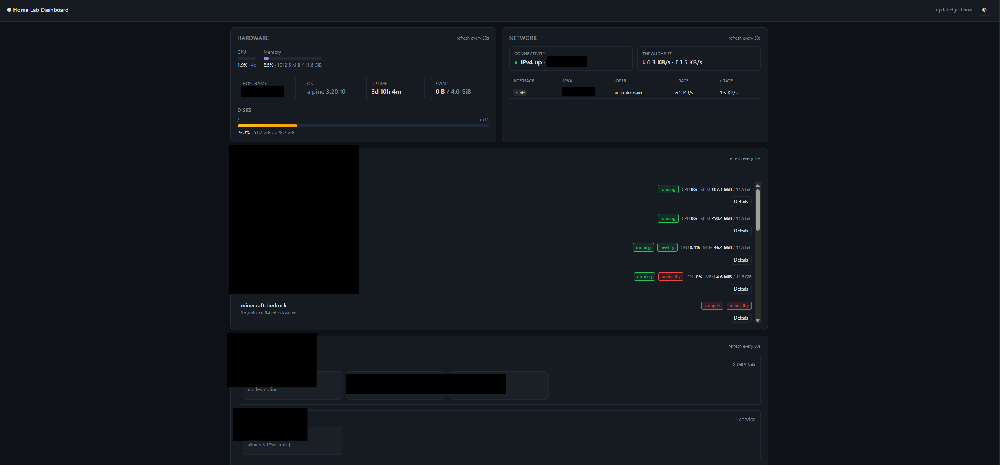

# Home Lab Dashboard



<div align="center">

[](https://go.dev/)
[](Dockerfile)
[](LICENSE)

</div>

A self-hosted, single-binary dashboard for a homelab host. No SPA, no
database, no third-party browser dependency — just `net/http`,
`html/template`, an in-memory atomic snapshot, and a small vanilla-JS
poller.

## Purpose

Four auto-refreshing cards give you a single view of the host:

| Card | What it shows | Source |
| --- | --- | --- |
| **Hardware** | CPU, memory, swap, disks, optional temperature, hostname, OS, uptime | `gopsutil/v3`, `/proc`, `/sys/class/thermal/*` |
| **Network** | Interfaces, link state, addresses, bandwidth rates, public IP | `gopsutil/net`, `/sys/class/net`, optional HTTPS IP echo |
| **Containers** | State, health, CPU/memory usage, inline start/restart/stop | Docker SDK via `DOCKER_HOST` |
| **Services** | Compose projects with metadata labels | YAML scan of `COMPOSE_SCAN_PATH` roots |

The poller is the **only writer** of the snapshot, HTTP handlers are
read-only consumers. Docker is optional: if it disappears, the card
keeps showing the last good container list and marks it stale instead
of blanking out.

## Why

A bare-minimum homelab overview that:

- **Boots fresh.** One binary, embedded assets, no migrations, no
  database.
- **Recovers gracefully.** A transient Docker outage doesn't wipe the
  container list, and `/readyz` returns `503 priming` until the first
  tick completes so any reverse proxy or orchestrator can wait it out.
- **Stays behind a reverse proxy.** Plain HTTP internally, TLS handled
  upstream (e.g. Nginx Proxy Manager).
- **Is small enough to audit in one sitting.** Single Go module, fewer
  than twenty dependencies, no front-end framework.

## Versions

| Component | Version | Source |
| --- | --- | --- |
| Go | `1.25.0` | `go.mod` (`go 1.25.0`) |
| `gopsutil/v3` | `v3.24.5` | `go.mod` |
| `docker/docker` SDK | `v25.0.6+incompatible` | `go.mod` |
| `gopkg.in/yaml.v3` | `v3.0.1` | `go.mod` |
| Toolchain floor | `>= 1.25.0` | required by go.opentelemetry.io/contrib/.../otelhttp v0.69.0 |
| Runtime image | `alpine:3.20` | `Dockerfile` |
| Final image size | ~22 MB compressed | `Dockerfile` |
| Runtime RAM | <50 MB | `Dockerfile` |
| Binary version | `dev` locally; set at build via `-ldflags "-X main.version=..."` | `main.go` |

## Quick Start (Docker Compose)

The shipped `docker-compose.yml` targets one specific host. Adjust these
first:

| Placeholder | Value in repo | Replace with your own |
| --- | --- | --- |
| Published port | `3051:3001` | any free host port |
| External network | `npm_network` | your reverse-proxy network |
| Compose scan mount | `/home/alkiory/projects:/projects:ro` | a directory of compose files |
| Compose scan path | `/projects` | the matching in-container path |

Then:

```bash
docker compose build
docker compose up -d
docker compose ps
docker compose logs -f --tail 200 home-lab-dashboard

curl -fsS http://localhost:3051/healthz   # → ok
curl -fsS http://localhost:3051/readyz    # → ready (503 priming until first tick)
```

The compose file includes `tecnativa/docker-socket-proxy` as
`hld-docker-proxy`, so the dashboard never touches
`/var/run/docker.sock` directly — it talks to
`DOCKER_HOST=tcp://hld-docker-proxy:2375`.

## Local Development

If the default Go cache is unwritable, fall back to a writable path:

```bash
GOCACHE=/tmp/hld-go-cache go test ./...
GOCACHE=/tmp/hld-go-cache go build .
```

Run directly:

```bash
PORT=3001 \
POLLING_INTERVAL=15s \
COMPOSE_SCAN_PATH=/path/to/stacks \
ENABLE_PUBLIC_IP=0 \
go run .
```

To fetch live container data while running on the host, point the SDK
at one of:

```bash
DOCKER_HOST=unix:///var/run/docker.sock      # direct socket
DOCKER_HOST=tcp://localhost:2375            # TCP (e.g. socket-proxy on host)
```

Docker is optional — without it, the Containers card reports "Docker is
unavailable" while Hardware, Network, and Services keep rendering.

Environment knobs (defaults from `internal/config/config.go`):

| Variable | Default | Notes |
| --- | --- | --- |
| `PORT` | `3001` | Internal HTTP port. |
| `POLLING_INTERVAL` | `15s` | Accepts `30` (seconds) or `30s` / `1m` (duration). The shipped compose sets `30s`. |
| `DASHBOARD_TITLE` | `Home Lab Dashboard` | Header brand and `<title>`. |
| `ENABLE_PUBLIC_IP` | `true` | Accepts `1/0`, `true/false`, `yes/no`, `on/off`. |
| `LOG_LEVEL` | `info` | `debug`, `info`, `warn`, `error`. |
| `COMPOSE_SCAN_PATH` | _unset_ | Comma-separated scan roots. |
| `DOCKER_HOST` | _unset_ | SDK endpoint; compose sets `tcp://hld-docker-proxy:2375`. |

## Troubleshooting

| Symptom | First check |
| --- | --- |
| **Cards stuck on "Loading…" or "Unable to load data"** | `curl -i http://localhost:3051/api/cards/{hardware,network,containers,services}` then `docker compose logs --tail 200 home-lab-dashboard`. Template render failures appear as HTTP 500 with `card render failed`. |
| **`/readyz` returns `503 priming`** | Poller hasn't finished the first tick. If it persists past one `POLLING_INTERVAL`, check `docker compose logs -f home-lab-dashboard` for collector hangs. |
| **Containers card says "Docker is unavailable"** | `docker compose ps`, `docker compose logs --tail 200 hld-docker-proxy`, `docker compose exec home-lab-dashboard sh -c 'echo "$DOCKER_HOST"'`. Expected: `tcp://hld-docker-proxy:2375`. |
| **Services card is empty** | `docker compose exec home-lab-dashboard sh -c 'echo "$COMPOSE_SCAN_PATH"; find /projects -maxdepth 4 \( -name compose.yml -o -name compose.yaml -o -name docker-compose.yml -o -name docker-compose.yaml \)'. Confirm the env is set, the host directory is mounted read-only, files are within three directory levels of a scan root, and the filenames match the recognized list. |
| **Public IP is missing** | `ENABLE_PUBLIC_IP=0` or outbound HTTPS blocked. Set `ENABLE_PUBLIC_IP=0` to disable entirely. |
| **Hardware metrics look like container metrics** | Verify `/proc:/proc:ro` and `/sys:/sys:ro` mounts exist on the stack. Add explicit read-only mounts for any host path that should appear in the dashboard. |
| **Container start/restart/stop never returns** | The server enforces a 20 s timeout on `POST /api/containers/{id}/{action}`. If a call hangs, the underlying Docker op is stuck — check `docker ps` from the host. |
| **`go test ./...` reports `[no test files]`** | Expected — the repo currently ships without tests. See `knowledge.md` for first-test suggestions. |

## License

[MIT](LICENSE) — Copyright (c) 2026 Alkiory.
